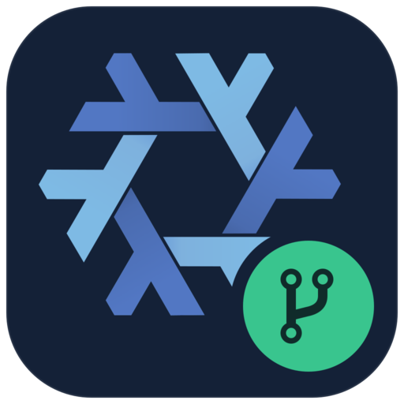
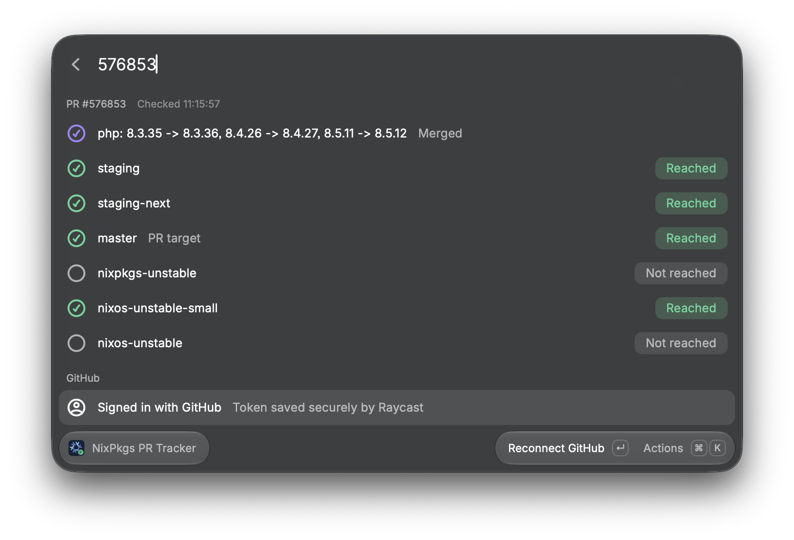

<p align="center">
  
</p>

<h1 align="center">NixPkgs PR Tracker</h1>

<p align="center">Merged is only the beginning. See which branches your Nixpkgs PR has reached — right from Raycast.</p>

<p align="center">
  <a href="https://github.com/kontsevoye/raycast-nixpkgs-tracker/actions/workflows/ci.yml"></a>
  <a href="https://github.com/kontsevoye/raycast-nixpkgs-tracker/releases"></a>
  <a href="LICENSE"></a>
</p>

<p align="center">
  
</p>

## Features

- **Follow a PR through Nixpkgs:** staging, staging-next, master and your selected channel branches.
- **Paste a number or URL:** accepts `576853`, `#576853`, GitHub PR links and `track.nix.ee` links.
- **Sign in with GitHub:** browser authorization, secure token storage and automatic session restoration. No token copying required.
- **Bring your own token:** an optional password preference is available instead of browser sign-in.
- **Return to recent PRs:** locally saved history with fresh checks whenever you reopen a PR.
- **See what happened:** reached, not reached and failed checks are distinct states.
- **Choose your branches:** customize the list in preferences; the PR's target branch is included automatically.

Requests go directly to the GitHub API. No tracker account or self-hosted service is needed.

## Installation

Requires macOS, a recent version of [Raycast](https://www.raycast.com/), and
[Nix with flakes enabled](https://nix.dev/install-nix).

```sh
git clone https://github.com/kontsevoye/raycast-nixpkgs-tracker.git
cd raycast-nixpkgs-tracker
nix develop
npm run dev
```

The official Raycast CLI imports the extension. Once the build is ready, stop the
watcher with `Ctrl+C`; the command remains installed. Search for **Track NixPkgs PR**
in Raycast to use it.

`nix develop` supplies Node.js 22, npm and all JavaScript dependencies from the
committed lock files. No global Node/npm installation or separate `npm ci` is needed.

Prebuilt `.rayext` bundles are also available in [Releases](https://github.com/kontsevoye/raycast-nixpkgs-tracker/releases).

## Usage

1. Open **Track NixPkgs PR** in Raycast.
2. Enter a PR number or paste a link, then press Return.
3. Check the branch list. Press **⌘R** to refresh.

Use **⌘K** for actions: open the PR or a branch on GitHub, copy links, show
details, sign in, or open extension preferences.

The default refs are `staging`, `staging-next`, `master`, `nixpkgs-unstable`,
`nixos-unstable-small` and `nixos-unstable`. For macOS users,
`nixpkgs-unstable` is often the channel of interest. Add release refs such as
`nixos-26.05` or `release-26.05` in **Branches to Check**.

The screenshot is a native macOS window capture with transparent edges and the original window shadow. It shows real API results at capture time; branch statuses change as updates propagate.

## GitHub sign-in

Select the GitHub row and choose **Sign in with GitHub**. Complete authorization
in your browser and return to Raycast. Raycast stores the tokens securely and
restores the session next time you open the command. Expiring sessions with a
refresh token are refreshed through Raycast's OAuth service.

The extension requests **no additional OAuth scopes**: reading public Nixpkgs
data is enough. Raycast uses a shared OAuth app, so GitHub may display permissions
you previously granted to that app. You can sign out from the extension or revoke
the upstream authorization in your GitHub application settings.

Alternatively, enter a token in **GitHub Personal Access Token** in preferences.
That token takes precedence over browser sign-in until you clear it. Anonymous
use also works, with GitHub's lower request limit. Signing in increases the API
allowance; it does not guarantee faster individual requests.

## How the checks work

The extension reads the PR's merge commit, then compares that commit with each
selected branch using GitHub's REST API. Checks run with at most three requests
in parallel. An `ahead` or `identical` comparison means the branch contains the
merge commit; `behind` or `diverged` means it does not.

Open and closed-but-unmerged PRs are shown without branch comparisons. Network,
authentication, missing-ref and rate-limit failures are shown as errors.

Backports and cherry-picks have different commits: track the backport PR separately.
Branch presence also does not prove that a particular package builds or is in a
binary cache. Checks run on demand; background polling and notifications are not included.

## Development

```sh
nix develop --command npm run check
```

The same command runs locally and in CI: tests, production build, type checking,
ESLint, Prettier, workflow/Nix formatting checks, and bundling. The devShell pins
the toolchain through `flake.lock` and uses `importNpmLock` to build/link
`node_modules` from `package-lock.json`, including integrity-checked npm tarballs.
It supports macOS and Linux on ARM64 and x86-64; the extension itself targets macOS.

Inside `nix develop`, individual commands such as `npm test`, `npm run dev` and
`npm run bundle` are also available. `npm run bundle` creates `nixpkgs-tracker.rayext`.
Python and ImageMagick are included for `python3 scripts/make-icon.py`.

To change a JavaScript dependency, run `npm install package@version` inside the
devShell. The project's `.npmrc` makes this a lock-file-only update; leave and
re-enter `nix develop` to rebuild/link the dependencies. Commit both package files.
Use `nix flake update` to update the pinned toolchain and commit `flake.lock`.

If migrating an older npm-based checkout, move aside the existing `node_modules`
directory once before entering the devShell. Nix owns this directory afterwards.

`npm run lint:store` additionally validates Raycast Store metadata, including a
registered Raycast author username. Local installation does not require a Store account.

## Automatic releases

Every push to **main** runs the shared Nix checks. After success, GitHub Actions
creates a SemVer tag and publishes the exact checked `.rayext` bundle with generated
release notes. PRs and manual check runs do not publish releases.

| Changes since the previous stable tag                               | Increment | Example             |
| ------------------------------------------------------------------- | --------- | ------------------- |
| Default, including `fix:`, `docs:`, `ci:` and unstructured messages | Patch     | `v0.1.0` → `v0.1.1` |
| `feat:` or `feat(scope):`                                           | Minor     | `v0.1.0` → `v0.2.0` |
| `type!:` / `type(scope)!:` or a `BREAKING CHANGE:` footer           | Major     | `v0.1.0` → `v1.0.0` |

The highest level across all unreleased commits wins. Re-running a workflow for
the same tagged commit finishes or reuses its release instead of allocating another
version. See [release behavior and recovery](docs/RELEASING.md).

## Credits and license

Inspired by [ocfox/nixpkgs-tracker](https://github.com/ocfox/nixpkgs-tracker) and its
direct GitHub API approach. The Raycast implementation is developed independently.

Code is licensed under [MIT](LICENSE). The icon adapts the official **Nix Snowflake**
by Simon Frankau and Tim Cuthbertson, with a dark background and a green pull
request badge. Logo assets are licensed under **CC BY 4.0**; see
[attribution and source details](ATTRIBUTION.md). This is an independent community
extension.
